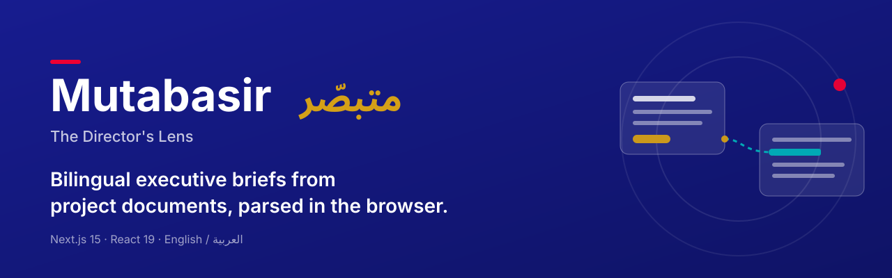
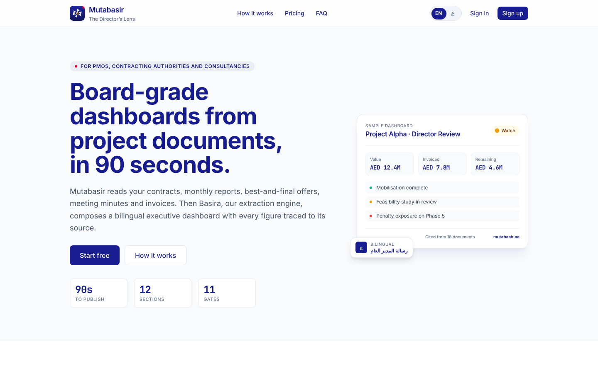
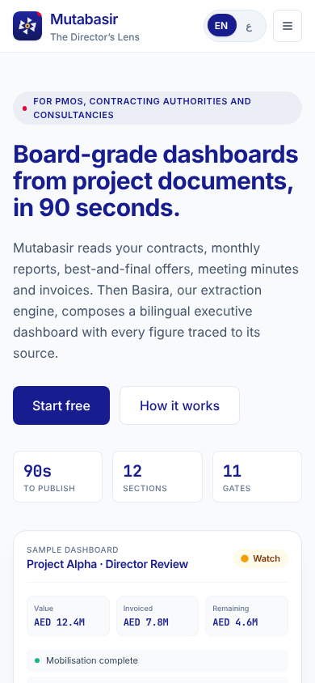
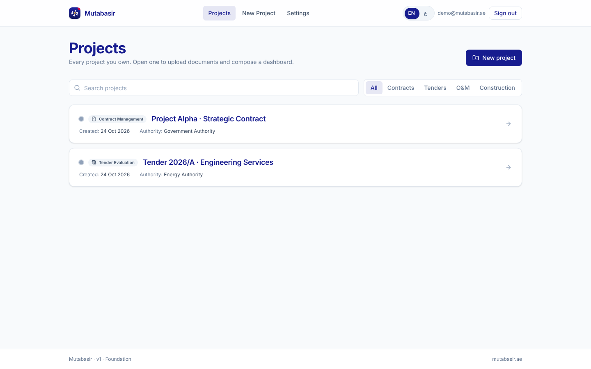
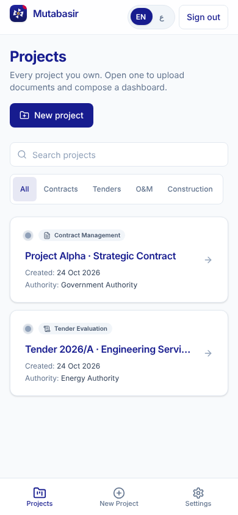
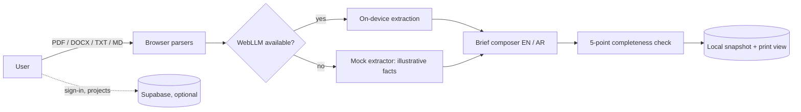

<p align="center">
  
</p>

<p align="center"><strong>Bilingual executive briefs from project documents, parsed in the browser.</strong></p>

<p align="center">
  
  
  
  
  
  
  
</p>

<p align="center">
  <a href="#overview">Overview</a> ·
  <a href="#key-features">Features</a> ·
  <a href="#screenshots">Screenshots</a> ·
  <a href="#quick-start">Quick start</a> ·
  <a href="#deploy-on-vercel">Deploy</a> ·
  <a href="#status-and-known-limitations">Status</a> ·
  <a href="#ملخص-بالعربية">العربية</a>
</p>

## Overview

Mutabasir (متبصّر) turns uploaded project documents into a bilingual (English
and Arabic) executive brief. Documents are parsed in the browser. Facts can be
extracted by an optional on-device model, then composed into a brief for a
chosen audience and published as a print-ready page.

**Upload → Extract → Brief → Publish**

> **Which repository is this?** This repository is an earlier snapshot of the
> Mutabasir codebase. The [`ahmadzayan-hub/mutabasir`](https://github.com/ahmadzayan-hub/mutabasir)
> repository contains a later version of the same app with additional evidence
> controls (source-span matching, numeric checks and human review before
> publication). Older notes that point to a `desktop-tutorial` branch are
> historical.

## Key features

- **Upload.** PDF, DOCX, TXT and MD, up to 25 files. Parsed locally with
  `pdfjs-dist` and `mammoth`. Nothing is uploaded to a server during extraction.
- **Extract.** Optional on-device AI through WebLLM on WebGPU browsers
  Seven selectable models, from SmolLM2 360M to Phi 3.5 mini 3.8B (Qwen 2.5,
  Llama 3.2 and Gemma 2 in between). Each fact carries a confidence level and
  a citation.
- **Brief.** Template-based English and Arabic brief in five audience registers:
  Director, CEO, Board, Internal team and External client. Copy or download as
  `.md`.
- **Publish.** A five-point completeness check (documents, facts, brief, a
  high-confidence fact, a risk item), local snapshot, and a print-optimized
  `/projects/[id]/published` page (A4 portrait).
- **Projects.** List with text search, subject filters and a live result count.
- **Bilingual UI.** Full English and Arabic interface with RTL layout.
- **Demo mode.** Runs with no environment variables: sign-in is simulated and
  projects live in a browser cookie. Supabase auth and Postgres are used when
  configured.
- **PWA.** Manifest, service worker and install prompt. `/api/health` endpoint.

## Screenshots

Captured from a local production build in demo mode (no Supabase), after
loading the built-in sample projects. The sample projects are synthetic.

| Desktop (1440 × 900) | Mobile (390 × 844) |
| --- | --- |
|  |  |
|  |  |

## Quick start

Requires Node.js 22 and npm 10.

```bash
git clone https://github.com/ahmadzayan-hub/mutabasir-director-lens-.git
cd mutabasir-director-lens-
npm ci
npm run dev        # http://localhost:3000
```

With no `.env.local` the app runs in demo mode. Open `/projects` and choose
**Load sample projects** to try the pipeline with synthetic data.

Optional Supabase persistence:

```bash
cp .env.example .env.local
# fill in NEXT_PUBLIC_SUPABASE_URL, NEXT_PUBLIC_SUPABASE_ANON_KEY, DATABASE_URL
npm run db:apply   # applies supabase/migrations/*.sql
```

Only run `db:apply` against a development database you control. It writes
schema state.

## Scripts

| Command | Purpose |
| --- | --- |
| `npm run dev` | Next.js dev server |
| `npm run build` | Production build |
| `npm run start` | Serve the production build |
| `npm run lint` | ESLint (`next/core-web-vitals` + `next/typescript`) |
| `npm run typecheck` | `tsc --noEmit` |
| `npm test` | Vitest, 45 tests across 7 files |
| `npm run test:watch` | Vitest in watch mode |
| `npm run db:apply` | Apply Supabase migrations via `pg` and `DATABASE_URL` |

## Project structure

```text
src/
  app/
    _landing/            landing page sections
    (auth)/              sign-in and sign-up
    (app)/projects/      project list, pipeline (upload, extract, brief, publish), published view
    (app)/new/           new project form and sample-project seeding
    (app)/settings/      settings and self-test panel
    api/health/          health check route
  components/            UI kit, motion, branding, agents panel
  lib/
    parsers/             PDF / DOCX / text parsing
    llm/ extraction/     WebLLM engine, LLM and mock extractors
    brief/               bilingual brief composer
    agents/              agent registry and orchestrator
    store/               local pipeline store and Supabase store
    i18n/                English and Arabic dictionary
  middleware.ts          Supabase session refresh and route gating
supabase/                migrations and storage bucket definitions
docs/                    architecture, deploy and prompt notes
```

## Architecture



The pipeline runs in the browser and stores its state locally. Supabase holds
auth and project records only when configured. See
[docs/ARCHITECTURE.md](docs/ARCHITECTURE.md) for the original design notes,
which also describe planned work that is not built.

## Deploy on Vercel

The repository includes a `vercel.json`. The production build succeeds with no
environment variables set; the deployed app then runs in demo mode.

| Setting | Value |
| --- | --- |
| Framework preset | Next.js |
| Root directory | `.` (repository root) |
| Install command | `npm install` (from `vercel.json`) |
| Build command | `next build` |
| Output directory | `.next` |
| Node.js version | 22.x |

Environment variables (all optional for a demo deploy):

| Variable | Scope | Used for |
| --- | --- | --- |
| `NEXT_PUBLIC_SUPABASE_URL` | Browser + server | Enables Supabase auth and project storage |
| `NEXT_PUBLIC_SUPABASE_ANON_KEY` | Browser + server | Supabase public key |
| `NEXT_PUBLIC_APP_URL` | Browser + server | Canonical URL for metadata, sitemap and robots |
| `SUPABASE_SERVICE_ROLE_KEY` | Server only | Listed in `.env.example`; never expose to the browser |
| `ANTHROPIC_API_KEY` | Server only | Only shown as configured/not configured on Settings |
| `NEXT_PUBLIC_DEFAULT_THEME` | Browser | Listed in `.env.example` |
| `DATABASE_URL` | Local only | `npm run db:apply`; do not add to Vercel |

More detail: [docs/DEPLOY.md](docs/DEPLOY.md).

## Status and known limitations

Verified on 24 October 2026 on this branch: `tsc --noEmit` clean, `next lint`
clean, 45 of 45 Vitest tests passing, `next build` successful without secrets.
There is no CI workflow in this repository.

- **Mock facts are not evidence.** Without WebLLM, the mock extractor generates
  illustrative facts from the project subject and file names. They are not read
  from document content. Treat any brief built from them as a demo.
- **Completeness is not verification.** The five-point publish check confirms
  that documents, facts and a brief exist. It does not confirm that a fact
  matches its source. Publishing needs documents, facts and a brief.
- **Local storage.** Documents, facts, briefs and snapshots live in the browser.
  Supabase covers auth and project records only.
- **Model download.** WebLLM needs a WebGPU browser and a model download of
  several hundred MB. Tests mock the model; they do not prove a real download.
- **Marketing copy.** Landing and pricing pages describe the product vision,
  including timing claims that have not been measured. Use this README for what
  the code does today.

For a version with source-bound evidence checks, use
[`ahmadzayan-hub/mutabasir`](https://github.com/ahmadzayan-hub/mutabasir).

## ملخص بالعربية

<div dir="rtl" lang="ar">

**متبصّر** تطبيق يحوّل مستندات المشاريع إلى موجز تنفيذي باللغتين العربية
والإنجليزية. تُحلَّل الملفات داخل المتصفح دون رفعها إلى خادم، ويمكن استخراج
الوقائع بنموذج ذكاء اصطناعي اختياري يعمل على الجهاز نفسه، ثم إعداد الموجز لجمهور
محدد ونشره في صفحة جاهزة للطباعة.

- يعمل التطبيق في وضع تجريبي دون أي مفاتيح، ببيانات تجريبية غير حقيقية.
- عند تعذّر تشغيل النموذج على الجهاز تُنشأ وقائع توضيحية لا تستند إلى محتوى
  المستندات، فلا تُعدّ دليلًا.
- فحص النشر يتأكد من اكتمال العناصر فقط، ولا يتحقق من مطابقة الوقائع لمصادرها.
- هذا المستودع نسخة سابقة، والنسخة الأحدث ذات ضوابط الأدلة موجودة في مستودع
  `ahmadzayan-hub/mutabasir`.

</div>

## License and ownership

No license file is present in this repository. This README does not grant a
license. All rights are reserved by the owner unless a license is added.

Built by Beyond Connect General Trading L.L.C · Dubai, UAE.
